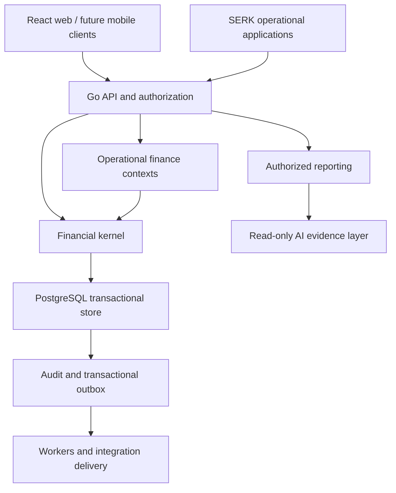

# Master architecture

SERK Finance owns financial truth across standalone installations and the wider SERK platform. Construction, Express, Retail, Manufacturing, Hotel, and HR own their operational facts. They submit versioned business facts to Finance; they never mutate its ledger or maintain competing statutory ledgers.

## Architecture and deployment boundary

Start with one Go application deployment, one PostgreSQL database cluster per deployment cell, and independently scalable workers when introduced. Within the application, bounded contexts communicate through explicit application ports, immutable event envelopes, and narrowly defined queries. Deployment independence is not required for domain independence.

The diagram is the target architecture. The current code implements API, authorization, organization provisioning, the manual-journal kernel, trial balance, and audit/outbox persistence. Workers, operational subledgers, mobile, and AI remain designed boundaries.

## Source layout

| Path | Responsibility |
|---|---|
| `cmd/api` | Runtime HTTP process; no provisioning/migration imports |
| `cmd/migrate` | Operator-controlled, checksummed transactional migrations |
| `cmd/bootstrap` | Initial organization/security provisioning |
| `internal/accounting` | Exact monetary value objects and request-level invariants |
| `internal/auth` | Password hashing, session entropy and digests |
| `internal/platform/database` | Separate pools, transaction lifetime, identity binding |
| `internal/platform/httpapi` | Typed HTTP adapters, authorization context, safe errors |
| `internal/provisioning` | Operator-only initial company configuration |
| `migrations` | Authoritative posting transitions, constraints, financial repositories |
| `web` | React/TypeScript interface; no authoritative tax or posting logic |
| `docs/domains` | Contracts and acceptance gates for all 36 requested domains |

## Accounting authority

Go owns transport, business intent validation, value objects, and orchestration. PostgreSQL owns the final atomic posting gate, durable state transitions, and independent enforcement of money invariants. The database boundary is deliberately stronger than a normal ORM application: runtime roles cannot insert, update, or delete ledger tables directly.

This is one financial model with two enforcement layers, not two competing business engines. Application tests and database adversarial tests verify equivalent rules. Country packs and future Python/OCR services must invoke these command ports; they cannot implement an alternative posting path. No Python service exists in this release.

## Transaction boundaries

The manual journal command transaction includes identity resolution, company/branch authorization, an idempotency lock, a request digest, source journal rows, currency conversion, lifecycle checks, audit evidence, outbox event, and the stored response. Commit is the success boundary. A returned response is written only after successful commit. Deferred audit triggers run before commit completes.

For future AP/AR and inventory modules, one local database transaction must cover the source-document transition, tax snapshot, subledger movement, balanced journal, audit, outbox, and idempotency receipt. Publishing to a broker or calling a bank inside that transaction is prohibited. External outcomes require explicit state machines and reconciliation.

## Read models

The initial trial balance queries posted journals and functional amounts from the primary database under the same company/branch policies. Reversed originals remain in the ledger; the reversal contributes opposite entries. Reporting replicas and analytical projections are introduced only with visible `as_of`, source sequence, and freshness. Eventually consistent dashboards must not authorize payments from stale cash positions.

## Multi-company and tenancy

A tenant can contain multiple legal companies. Membership in one company does not imply access to another. Branch restrictions apply to journals, lines, and their projections; shared company reference data is separately authorized. Tenant-scoped users can have multiple company-specific roles. Effective access is evaluated from active sessions and stored memberships, not caller-supplied user IDs.

Financial tables include tenant/company identifiers in foreign keys. UUID uniqueness alone is not a tenant boundary. Security tables are private to narrowly scoped functions; financially readable tables use forced RLS. Separate API and authentication login roles prevent the normal financial DB credential from creating sessions.

## Extension and extraction strategy

Add application ports for `PostingRequest`, `TaxCalculation`, `ApprovalDecision`, `DocumentEvidence`, `ReconciliationResult`, and `BusinessEventReceipt`. Integration consumers use an inbox unique key `(tenant, company, producer, event_id)`, semantic deduplication on the business source, expected aggregate versions, and schema-version validation. Event delivery is at least once. Financial effects are deduplicated transactionally.

First extraction candidates are OCR, reporting generation, notifications, and integration delivery. Extract the authoritative posting service only when profiling identifies a reason and all cross-domain atomic boundaries have a documented replacement. Do not extract AP and its GL posting into independently committing services merely to increase service count.

## Scale and operations

Use stateless API replicas, bounded DB pools, cursor pagination, and workload-specific statement/lock timeouts. Redis can add shared rate limits and caches keyed by tenant, company, authorization scope, and schema/policy revision. PostgreSQL remains authoritative for idempotency and locks. Adopt NATS or Kafka only when routing, volume, retention, or consumer requirements justify it.

The initial audit head serializes writes within a company to produce a contiguous hash chain. This is a deliberate integrity-first tradeoff and an identified throughput ceiling. Partition high-volume immutable events by deployment cell/company or time only after preserving global IDs, uniqueness, retained audit order, and cross-partition reconciliation. No 10,000-tenant capacity claim is made without representative load tests.

## Product experience

The accountant sees tasks and evidence, the approver sees the amount and reason, and the auditor sees the source chain. Future CEO/CFO views use report definitions, not separate financial arithmetic in React. Unsupported modules remain absent from navigation. Keyboard commands expose actual working routes. Offline and AI surfaces must label provisional or uncertain information at the point of use.

## Primary design references

PostgreSQL documents that table owners and privileged roles can bypass ordinary RLS and explains forced policies; this motivates the non-owner runtime identities. [Row security](https://www.postgresql.org/docs/17/ddl-rowsecurity.html).

Definer functions use explicit trusted search paths and restricted execution grants. [CREATE FUNCTION](https://www.postgresql.org/docs/17/sql-createfunction.html).

Audit events use deferred constraint triggers within the same transaction. [CREATE TRIGGER](https://www.postgresql.org/docs/17/sql-createtrigger.html).
