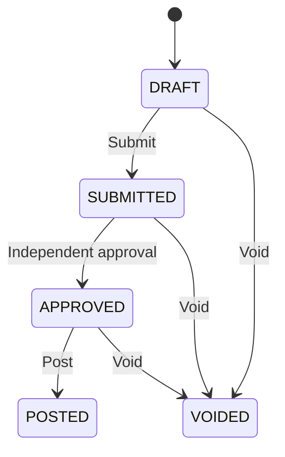

# Financial kernel update — 0.2.0-rc2

This release rechecks an approver's active status, permission, branch and approval ceiling when posting; adds durable period-close replay; blocks reinterpretation of used currency/fiscal definitions; and serializes journal creation against those definitions. See [FINANCIAL_VALIDATION.md](../FINANCIAL_VALIDATION.md) for evidence and remaining native gates. The original manual-journal model below is preserved.

# Accounting engine

## Implemented aggregate

`Journal` owns header, numbered lines, typed dimension links, lifecycle version, source/reversal link, reason, and approval identities. A journal belongs to one tenant, legal company, branch, fiscal period, original currency, and functional-currency snapshot. Cross-company transactions require separate linked journals, not mixed-company lines.

Amounts arrive as canonical integer strings in currency minor units. Go uses `math/big`; PostgreSQL uses a checked exact `numeric` domain. Each line amount is nonnegative, integral, and below 10^28. A source line has exactly one positive original debit or credit; an optional generated rounding line has zero original amounts and one positive functional side. No binary floating-point value is accepted by the financial API. PostgreSQL unconstrained numeric plus explicit integer checks prevents silent rounding of fractional minor-unit inputs.

## Posting invariants

1. Between 2 and 500 lines; total original debit equals total original credit and is positive.
2. Total functional debit equals total functional credit and is positive.
3. Every functional amount agrees with the stored original amount, rate, and currency exponents.
4. Same-currency journals use rate 1. Rates are positive finite decimals with at most 12 fractional digits.
5. Accounts are active, posting-enabled, leaf accounts, and belong to the same company. Manual journals cannot write subledger control accounts.
6. Dimensions exist in the same company and are active; only one value per kind is permitted on a line.
7. The branch is active. The accounting date belongs to an open period.
8. The approver is different from both creator and submitter. Approval permissions and the branch/amount ceiling apply.
9. The expected aggregate version matches. The identity and approval record cannot be supplied or overwritten by a client.
10. Reversal lines and dimensions exactly invert/copy the original, including the original functional amounts.

Validation runs before submission and approval and again before posting. Account configuration rows are locked before the final active/posting checks. The period row is shared-locked through commit, making a concurrent period close serialize with posting on native PostgreSQL.

## State machine

Posted and voided headers cannot be directly modified or deleted. Journal content is create-once in this release, including drafts; changing a draft currently means voiding it and creating a corrected draft. An editable-draft command with explicit optimistic versions and line-change audit is still required for the full product.

`REVERSED` is a read projection when a separately approved reversal has posted. The original remains `POSTED` in storage and retains every field. Both original and reversal appear in reports. A unique active reversal link prevents duplicate reversals, including simultaneous requests with different idempotency keys. A voided reversal does not permanently block correction.

## Currency arithmetic

`functional_minor = round(original_minor × fx_rate × 10^(functional_exponent − original_exponent))`.

Positive line-side values use nearest-unit, half-away-from-zero rounding. Reversal swaps the already-recorded amounts at the original rate; it does not recalculate using a new market rate. An original-balanced conversion difference requires an explicitly configured rounding account and a bounded cap. The engine adds one visible, audited functional-only line, included in normal independent approval. Unconfigured/excess differences still fail. See [FX rounding policy](fx-rounding-policy.md).

Rates are supplied and snapshotted on each manual journal. Rate ingestion, rate-source approval, triangulation, settlement gains/losses, revaluation and reporting-currency translation are not implemented.

## Idempotency and ordering

The database takes a transaction-scoped advisory lock derived from company, actor, and key. It compares a canonical JSONB digest of action plus payload, then atomically stores the response with the journal. Same key/same intent returns the original response, including its original version. Same key/changed intent raises a conflict. Replay rechecks current record access. Clients should GET the journal when they need its latest version after a replay.

Idempotency keys are scoped to the authenticated actor; cross-device business deduplication and external-event source keys will be added with offline/integration consumers. Idempotency receipts currently have no purge job. Retention must be designed before deletion is allowed, or an old retry could create another effect.

Numbers are allocated by a transactionally locked per-company/fiscal-year document counter. The configured prefix and fiscal-year name are preserved on the journal. At six digits and beyond, sequence formatting never truncates the number. Changing numbering configuration is an operator action in this release, not a runtime admin feature.

## Financial reporting boundary

The implemented trial balance reports cumulative or date-range debit/credit activity and net debit per account from posted functional amounts. A date range is an activity report unless opening balances are separately included. Negative net debit represents a credit balance. Original-currency values remain available on journal detail.

Balance sheet, income statement, cash-flow classification, opening/closing journal classification, recurring schedules, accrual reversal scheduling, source-document posting maps, and control-account reconciliations remain part of Phase 2/3. Do not infer that a correct trial balance establishes completeness of all statutory statements.

## Period completion and reversal date

Closing requires company-wide ledger.read as well as period.close. The period row lock serializes with creation/posting; the database refuses closure while any draft, submitted or approved journal remains, including other branches. The browser and GET close-preview show unfinished counts; the write transaction independently rechecks. Closed/locked periods cannot be reopened in this release. Existing unfinished entries in a previously closed period can be voided and recreated under an approved correction process; this release never silently re-dates or rewrites them. Reversals cannot predate their original journal.
